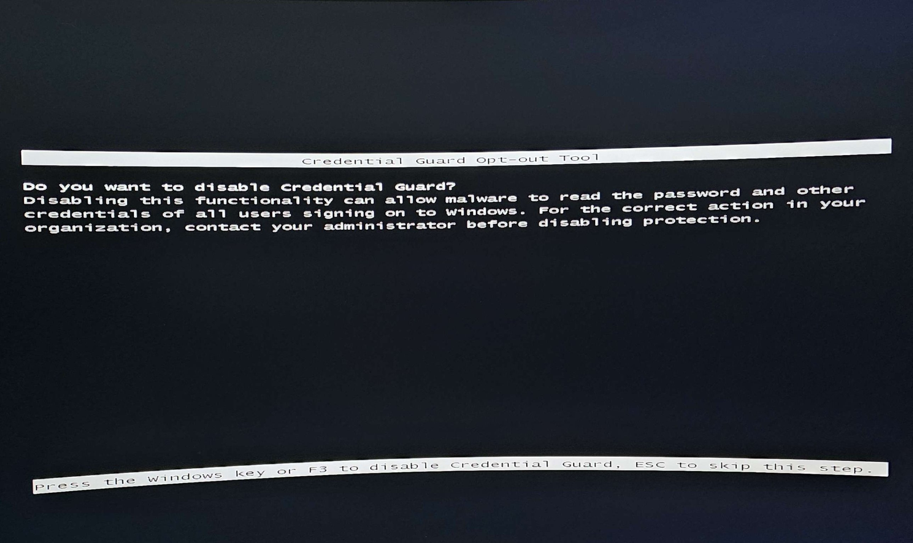

<table>
  <tr>
    <td valign="middle" width="78%">
      <h1>VBox Unlock · Windows 11</h1>
      <b>Disabilita Hyper-V, VBS, Isolamento core &amp; Credential Guard in un colpo solo · Per far girare VirtualBox alla massima velocità</b>
    </td>
    <td valign="middle" align="right" width="22%">
      
    </td>
  </tr>
</table>

<p align="center">
  
  
  
  
  
</p>

<p align="center">
  <a href="#-cosè">Cos'è</a> |
  <a href="#-leggi-prima-di-tutto">Leggi prima</a> |
  <a href="#-cosa-disabilita">Cosa disabilita</a> |
  <a href="#-come-si-usa">Come si usa</a> |
  <a href="#-il-riavvio-tasto-f3">Il riavvio (F3)</a> |
  <a href="#-verifica">Verifica</a> |
  <a href="#-ripristino">Ripristino</a> |
  <a href="#-english">English</a>
</p>

---

# 🛡️ Cos'è

**VBox Unlock** è un piccolo script `.bat` per **Windows 11** che spegne in un colpo solo tutta la sicurezza basata su virtualizzazione che rallenta o blocca **VirtualBox**: Hyper-V, Hypervisor Platform, VBS, Memory Integrity (Isolamento core), Credential Guard e il blocco firmware.

Sono tutti comandi **documentati da Microsoft** — niente trucchi, niente binari strani. Lo script li mette solo in fila, con la sintassi giusta e qualche controllo, così non devi copiarli a mano uno a uno.

> Perché serve? Su Windows 11 queste protezioni accendono l'hypervisor di sistema. Quando c'è, VirtualBox è costretto a girare *sopra* Hyper-V e va a scatti (o segnala "VT-x non disponibile"). Spegnendole, VirtualBox riprende l'accesso diretto alla virtualizzazione hardware.

# ⚠️ Leggi prima di tutto

Questo script **riduce di proposito la sicurezza del tuo PC**. È il suo scopo. Usalo solo se sai cosa stai facendo e su una macchina **personale**, mai su un PC aziendale o gestito da un'organizzazione.

| | |
| --- | --- |
| 🔐 **Abbassa la sicurezza** | Disattiva VBS, Credential Guard e Integrità memoria. Le credenziali in memoria diventano più esposte. Riattiva tutto se non ti serve più VirtualBox (vedi [Ripristino](#-ripristino)). |
| 💾 **BitLocker** | Se hai BitLocker attivo, al riavvio **potrebbe chiederti la chiave di ripristino**. Tienila a portata di mano *prima* di lanciare. |
| 🏢 **Niente PC aziendali** | Su macchine gestite da policy aziendali può rompere l'accesso o violare le regole IT. Non farlo. |
| 🐧 **WSL2 / Docker / Sandbox** | Dipendono dalla stessa virtualizzazione: dopo lo script **non partiranno** finché non riabiliti tutto. |
| 👤 **Serve amministratore** | Senza permessi admin i comandi falliscono. |

> ⚖️ **Usa a tuo rischio.** Testato su Windows 11 24H2. L'autore non è responsabile per perdita di dati o problemi di avvio. Fai un punto di ripristino prima, se puoi.

# 🧩 Cosa disabilita

Lo script lavora in 5 passi:

| Passo | Cosa fa |
| --- | --- |
| **1** | `bcdedit` hypervisor off + feature **Hyper-V**, **Hypervisor Platform**, **Virtual Machine Platform** |
| **2** | Feature dipendenti: **Windows Sandbox**, **WSL**, **Defender Application Guard**, **HostGuardian** |
| **3** | Registro: **Memory Integrity (HVCI)**, **VBS**, **Credential Guard** (`LsaCfgFlags`), **System Guard** |
| **4** | Servizi **Hyper-V** (`vmms`, `HvHost`, `vmcompute`) impostati su *disabilitato*, così non si riaccendono |
| **5** | Blocco firmware `SecConfig.efi` → conferma con **F3** al riavvio (vedi sotto) |

# 🎮 Come si usa

1. Scarica `disabilita-vbs-per-virtualbox.bat`.
2. **Tasto destro → Esegui come amministratore.**
3. Lascialo lavorare: è automatico, non devi premere invio. Dopo ~8 secondi riavvia da solo.
4. **Al riavvio premi F3** alla schermata di conferma ([vedi sotto](#-il-riavvio-tasto-f3)).
5. Apri VirtualBox: ora gira in modalità veloce. ✅

> Se un comando `dism` dà errore rosso è perché quella feature non era installata: **innocuo**, lo script prosegue da solo.

# 🔄 Il riavvio: tasto F3

Il passo 5 arma una procedura firmware di Microsoft. Al riavvio vedrai una **schermata nera/blu** come questa:

<p align="center">
  
</p>

È il **Credential Guard Opt-out Tool**. Qui Windows ti chiede conferma esplicita per disattivare la protezione:

- **F3** (o il **tasto Windows**) → **conferma** e disattiva
- **ESC** → salta questo passo (non disattiva nulla)

> Questa conferma manuale è voluta da Microsoft: serve proprio a impedire che un software disattivi VBS di nascosto. **Non è automatizzabile** — quel tasto lo devi premere tu, fisicamente. Se non premi nulla, la procedura si annulla e la sicurezza resta attiva.

# ✅ Verifica

Dopo il riavvio, controlla che sia andato tutto:

1. Premi `Win + R`, scrivi `msinfo32`, Invio.
2. Cerca la riga **"Sicurezza basata su virtualizzazione"**.
3. Deve dire **Non abilitata**.

Quella riga è la prova del nove, più affidabile di qualsiasi lista di comandi.

# ♻️ Ripristino

Ti serve di nuovo Hyper-V, WSL2 o Docker? Riattivi tutto con lo script gemello `ripristina-vbs.bat` (incluso nella repo), oppure a mano:

```bat
bcdedit /set hypervisorlaunchtype auto
bcdedit /deletevalue {bootmgr} bootsequence
bcdedit /delete {0cb3b571-2f2e-4343-a879-d86a144d7853}
sc config vmms start= demand
sc config HvHost start= demand
sc config vmcompute start= demand
```

Poi riabilita le feature da *Attiva o disattiva funzionalità Windows*, riaccendi **Integrità memoria** in *Sicurezza di Windows → Sicurezza dispositivo → Isolamento core*, e riavvia.

# 🔎 Parole chiave

<sub>
VirtualBox lento Windows 11 · disabilitare Hyper-V · VirtualBox VT-x non disponibile · disattivare VBS · Virtualization Based Security off · Isolamento core / Integrità memoria · Memory Integrity disable · Credential Guard opt-out · Device Guard · far girare VirtualBox veloce · VirtualBox Hyper-V conflitto · fix VirtualBox Windows 11 · raised to green / modalità lenta VirtualBox · disable Hyper-V Windows 11 · VirtualBox slow fix · bcdedit hypervisorlaunchtype off
</sub>

# ⚖️ Licenza

MIT — © 2026 **[SangueFreddo](https://github.com/SangueFreddo)**. Vedi [LICENSE](LICENSE).
Non affiliato a Microsoft od Oracle. VirtualBox è un marchio di Oracle; Windows e Hyper-V sono marchi di Microsoft.

---

# 🇬🇧 English

**VBox Unlock** is a small Windows 11 `.bat` script that turns off, in one go, all the virtualization-based security that slows down or blocks **VirtualBox**: Hyper-V, Hypervisor Platform, VBS, Memory Integrity (Core Isolation), Credential Guard and the firmware lock. Every command is **documented by Microsoft** — the script just lines them up with the right syntax so you don't copy them by hand.

### ⚠️ Read first
This script **deliberately lowers your PC's security**. Use it only on a **personal** machine, never on a work/managed PC. If **BitLocker** is on, it may ask for your recovery key at reboot — have it ready. **WSL2, Docker and Sandbox won't start** afterwards until you re-enable everything. Needs **administrator**. Use at your own risk; tested on Windows 11 24H2.

### 🎮 How to use
1. Right-click `disabilita-vbs-per-virtualbox.bat` → **Run as administrator**.
2. It runs unattended and reboots itself after ~8 seconds.
3. **At reboot, press F3** at the confirmation screen (the *Credential Guard Opt-out Tool*): **F3** or the **Windows key** to confirm, **ESC** to skip. This manual key press is a Microsoft safety measure and **cannot be automated** — you must press it physically.
4. Open VirtualBox — it now runs at full speed. ✅

### ✅ Verify
Open `msinfo32` and check **"Virtualization-based security"** → it must read **Not enabled**.

### ♻️ Restore
Run the companion `ripristina-vbs.bat`, or set `hypervisorlaunchtype auto`, delete the `DebugTool` boot entry, set the Hyper-V services back to `demand`, re-enable the Windows features and **Memory Integrity**, then reboot.

MIT · © 2026 **[SangueFreddo](https://github.com/SangueFreddo)**. Not affiliated with Microsoft or Oracle.
